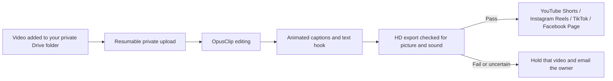

# Automated video publishing flow for social media creators

**Upload a video, drop it in your Google Drive folder, and let the cloud handle the rest.**

After a one-time setup, this flow privately ingests your footage, edits it into a full-length vertical video, removes unnecessary pauses, adds animated captions and a text hook, checks the actual finished export, and publishes passing videos to your connected social accounts. Your laptop can be switched off.



## What it does

- Checks a private Google Drive folder every five minutes and tracks videos by file ID.
- Resumes interrupted uploads from the last server-confirmed byte instead of starting over.
- Creates one full-length portrait project, preserving spoken content while cutting unnecessary pauses.
- Adds animated bottom captions, white text and green keyword highlighting.
- Adds an emoji-free, font-safe text hook for the opening three seconds.
- Applies subtle 25% colour correction and exports at 1080×1920 or better.
- Inspects the actual rendered video and audio before publication, rather than trusting a render-success flag.
- Publishes to exactly four configured destinations: YouTube Shorts, Instagram Reels, TikTok and one explicitly selected Facebook Page.
- Records project IDs, quality-review jobs, publishing tasks and platform results. Ambiguous public posts are never blindly repeated.
- Runs in Google Apps Script and OpusClip. GitHub Actions tests the software; it does not host a recurring media-processing service.

There is no routine approval step once public publishing is enabled. A technical or quality failure stops that particular video and triggers a notification.

## Start here

Follow **[SETUP.md](SETUP.md)**. You need your own private Drive folder, eligible OpusClip API/MCP access and credits, and social accounts connected to your OpusClip workspace. Keep all credentials and destination identifiers in private Google Script Properties.

The first run defaults to **processing and QC without public posting**. After your own sample passes, set `PUBLICATION_ENABLED` to `true`. New videos added after that point can publish automatically without a per-video approval.

The public repository contains reusable code and synthetic tests. It contains no original footage, live account IDs, deployment URLs, private status records, access tokens or copied operational Git history. Read **[PRIVACY.md](PRIVACY.md)** before adapting it.

## Is vidIQ hook optimisation included?

**No. The current release does not integrate vidIQ, read post-performance analytics, run hook A/B tests or learn new hooks from engagement.**

The current hook is derived from the video's filename, stripped to plain ASCII and limited to 72 characters. Give each video a useful descriptive filename. Visual QC checks the hook's wording, readability, position and timing; it does not prove that the hook attracts viewers.

A possible future extension is a measured feedback loop: record each hook and its published video IDs, retrieve authorised analytics, compare results at the same publication age, account for topic/length/audience differences, and use that evidence to generate better candidates for future videos. This is a roadmap item, not an existing autopilot feature. No vidIQ credentials or subscription are required by this release.

## Practical boundaries

- Sources must be longer than three seconds and no longer than three minutes. The full spoken content is retained; this is not an automatic best-moments clipping service.
- Final output must satisfy the configured HD portrait requirements. A failed export is held instead of silently publishing lower quality.
- Caption, audio, hook and picture checks are automated judgments. Video is sampled at 2 fps and audio is analysed; uncertainty fails closed. This is not fact-checking or a guarantee about every frame.
- Separate skin smoothing is not implemented. Colour correction is not described as skin smoothing.
- Initial folder contents are baselined and skipped. After activation, both new uploads and videos moved into the monitored folder are discovered by file ID, regardless of their original creation date.
- A held or ambiguous operation needs its specific problem reconciled. Removing durable records can defeat duplicate protection; do not routinely reset the state store.
- Five-minute polling is the detection/advancement interval, not an upload-to-publication deadline. Transfers, editing, rendering and platform confirmation add time.

## Cost and hosting

Google Apps Script is used within its free personal-account limits. The worker caps its own daily recorded runtime at 60 minutes; Google currently allows 90 minutes of trigger runtime per day for personal accounts, six minutes per execution, 50 MB per URL Fetch response and 500 KB of Script Properties. Chunks and checkpoints address transfer limits; the state store stops before it fills. This is intended for a modest creator cadence, not an unlimited queue. See [Google's quotas](https://developers.google.com/apps-script/guides/services/quotas).

OpusClip processing and video-understanding reviews consume your own credits. Check current access and pricing with OpusClip before enabling paid processing. The reference-analysis service can temporarily hold 15 credits; that hold is not a price cap. Actual charges are recorded against the original job, and retrieval does not start a replacement paid review.

## Code map

| File | Responsibility |
|---|---|
| `Config.gs` | Reads private settings and validates the exact four destinations |
| `Code.gs` | Drive access, resumable upload, file ledger, bounded retries and submission |
| `CloudOpus.gs` | PKCE OAuth, renewable tokens and official MCP transport |
| `Quality.gs` | Encoded MP4 inspection and rendered-video review prompt |
| `Workflow.gs` | Editing, QC fingerprinting, public-post intents and result reconciliation |
| `Operations.gs` | One-time setup, trigger activation, private status and pause controls |
| `*.test.cjs` | Synthetic regression and privacy checks, with no live API calls |

Run the offline checks with Node.js:

```sh
node --test *.test.cjs
```

## Official references

- [OpusClip agent setup](https://help.opus.pro/api-reference/agent-setup)
- [OpusClip API reference schema](https://help.opus.pro/api-reference/openapi.json)
- [OpusClip agent tools and editing-script examples](https://github.com/opus-pro/opus-skills)
- [Google Apps Script documentation](https://developers.google.com/apps-script)

This is an independent reference implementation. Provider access, API contracts, quotas and platform rules can change. The reusable configuration and offline tests are separate from the original private deployment; each adopter must verify their own account connections and end-to-end sample.
